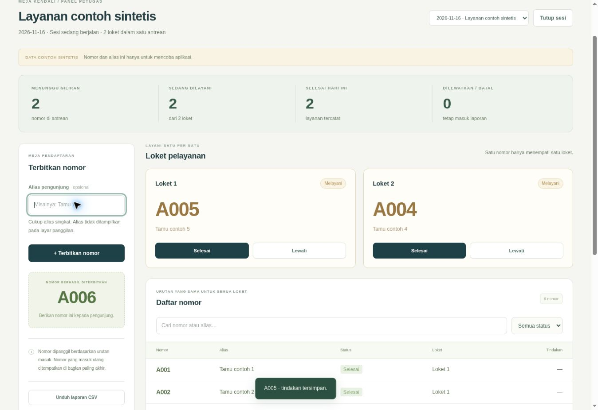
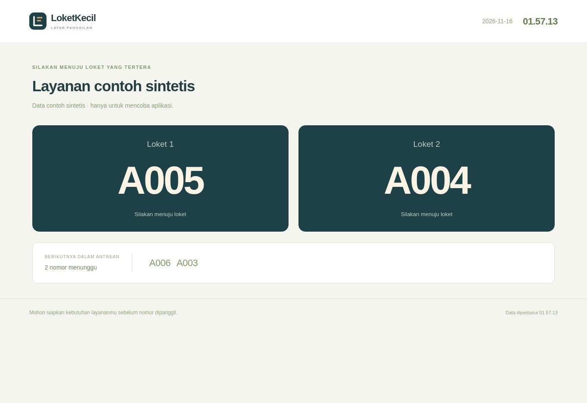

# LoketKecil

**Antrean sederhana untuk meja layanan dengan beberapa loket.** Terbitkan nomor, panggil pengunjung sesuai urutan, dan tampilkan nomor pada monitor kedua dari satu komputer. Data disimpan di SQLite dan tetap tersedia setelah aplikasi ditutup.

Ditujukan bagi panitia kegiatan kampus atau pengelola meja layanan kecil yang membutuhkan antrean datang langsung. Antarmuka berbahasa Indonesia; tidak perlu memasang database server atau paket pip.



## Lima fitur yang terhubung

- **Sesi layanan:** buka satu sesi per tanggal dengan 1–4 loket; sesi yang selesai menjadi arsip yang dapat dibaca kembali.
- **Nomor antrean:** terbitkan A001–A999, tambahkan alias opsional, cari/filter status, atau batalkan nomor yang masih menunggu.
- **Pelayanan FIFO:** panggil nomor berikutnya, selesaikan, lewati bila belum hadir, lalu masukkan kembali di bagian paling belakang jika pengunjung datang lagi.
- **Layar panggilan:** tampilan besar untuk monitor kedua, diperbarui otomatis, berisi nomor dan loket tanpa alias pengunjung.
- **Catatan dan pemulihan:** riwayat aktivitas, ekspor CSV, cadangan SQLite, serta percobaan ulang permintaan yang jawabannya belum dapat dipastikan.

## Mulai dalam satu menit

Butuh **Python 3.10+ dengan sqlite3** serta browser modern (Chrome, Edge, Firefox, atau Safari). Ekstrak ZIP terlebih dahulu; jangan menjalankan dari dalam arsip.

**Windows:** klik dua kali `Mulai_App.cmd`. Browser akan dibuka otomatis.

**Windows, macOS, atau Linux:** jalankan dari folder proyek:

```sh
python server.py
```

Pada sistem yang memakai nama `python3`, gunakan `python3 server.py`. Buka [http://127.0.0.1:8764/](http://127.0.0.1:8764/) jika browser belum terbuka. Aplikasi tidak membutuhkan koneksi internet. Terminal peluncur cukup dibiarkan terbuka; seluruh pekerjaan sehari-hari dilakukan melalui tombol dan form di browser. Tekan Ctrl+C di terminal untuk berhenti.

Pada database baru, pilih **Coba data contoh → Muat contoh**. Aplikasi menyiapkan lima nomor sintetis: A001 selesai, A002 sedang dilayani, dan A003–A005 menunggu. Contoh hanya dapat dimuat pada database kosong sehingga data layanan sebelumnya tidak tertimpa.

Untuk layanan nyata, pilih **Buka sesi**, isi nama, tanggal, dan nama loket. Terbitkan nomor, berikan nomor yang muncul kepada pengunjung, lalu gunakan **Panggil berikutnya** pada loket yang kosong. Pilih **Layar panggilan** dan pindahkan jendelanya ke monitor kedua. Nomor A001 dapat muncul lagi pada sesi tanggal lain; gunakan tanggal dan nomor bersama-sama saat membaca laporan.



## Jaminan perilaku yang diuji

**Dalam database LoketKecil yang valid, setiap tindakan mengubah antrean, versi loket, catatan aktivitas, dan rekaman permintaan dalam satu transaksi. Satu nomor tidak dapat sedang dilayani oleh dua loket. Pengiriman ulang dengan kunci dan isi yang sama mengembalikan hasil yang sudah tersimpan.**

SQLite `BEGIN IMMEDIATE` mengurutkan penulis. Pemilihan nomor FIFO dilakukan di dalam transaksi tersebut; indeks unik membatasi satu nomor aktif per loket. Versi yang diharapkan menolak tombol lama yang statusnya sudah berubah. Rekaman kunci idempotensi disimpan dalam transaksi yang sama dan tidak dihapus otomatis.

Browser menyimpan satu permintaan tertunda di `localStorage` **sebelum** mengirimkannya. Jika koneksi putus atau server mengembalikan kegagalan penyimpanan, tombol tindakan dikunci dan pengingat tetap ada setelah halaman dimuat ulang. Setelah memeriksa status, pilih **Coba ulang permintaan**. Aplikasi menggunakan kunci serta isi yang sama; tidak mengirim ulang otomatis saat halaman baru dibuka. Jangan membersihkan penyimpanan browser untuk menghilangkan pengingat yang belum dipastikan.

Jaminan ini dibuktikan oleh tes alur HTTP nyata, panggilan bersamaan pada dua loket, percobaan ulang setelah respons tidak dibaca, serta kegagalan penulisan catatan yang harus membatalkan seluruh transaksi. Rincian hasil ada di [catatan pengujian](docs/PENGUJIAN.md).

## Data, cadangan, dan batas penggunaan

- Database bawaan: `data/loketkecil.sqlite3`. Alias cukup berupa nama panggilan; jangan memasukkan NIK atau data sensitif lain.
- **Unduh cadangan database** menghasilkan snapshot SQLite yang konsisten, termasuk arsip dan kunci permintaan. Untuk mencoba pemulihan, hentikan aplikasi lalu jalankan `python server.py --db cadangan.sqlite3`. Simpan database lama terlebih dahulu; tidak perlu menimpanya. Memilih cadangan lama mengembalikan kondisi saat cadangan dibuat, sehingga data/kunci setelah waktu itu tidak tersedia. Pastikan semua permintaan tertunda sudah diperiksa sebelum berpindah database.
- **Unduh laporan CSV** berisi seluruh nomor sesi terpilih. Waktu pada CSV adalah UTC; waktu pada panel mengikuti zona waktu browser. Tanggal sesi yang diusulkan memakai WITA (UTC+8) dan dapat diedit sebelum sesi dibuat. CSV berawalan UTF-8 BOM; teks yang diawali formula spreadsheet diberi apostrof.
- Satu sesi aktif untuk seluruh aplikasi, satu sesi per tanggal, maksimal 999 nomor per sesi. Sesi tidak dapat ditutup saat masih ada nomor menunggu/dilayani. Nomor yang dilewatkan atau dibatalkan tetap tercatat. Sesi tertutup tidak dapat dibuka ulang.
- Gunakan **satu tab petugas aktif per browser**. Layar panggilan boleh dibuka terpisah. Backend menangani permintaan HTTP bersamaan, tetapi penyimpanan permintaan tertunda antar-tab browser tidak memiliki operasi compare-and-swap.
- Server hanya mendengarkan `127.0.0.1`; aplikasi ini untuk satu komputer, tanpa akun/login atau akses beberapa komputer lewat LAN/internet. Layar panggilan menyembunyikan alias pada responsnya, tetapi bukan batas otorisasi terhadap orang yang menguasai komputer tersebut.
- Belum ada suara panggilan, printer nomor, estimasi waktu tunggu, maupun integrasi sistem instansi. Jangan memakai aplikasi ini untuk penentuan prioritas medis/darurat. Tidak ada klaim tahan kerusakan media penyimpanan atau hasil uji lapangan.

Jika port sedang dipakai, gunakan `python server.py --port 8765`. Opsi `--no-browser` menonaktifkan pembukaan browser otomatis. Gunakan lokasi `--db` yang dapat ditulis. Database rusak atau skema asing ditolak saat startup dan tidak diganti otomatis.

## Mengapa masalah ini dipilih?

Halaman layanan Dukcapil Kota Mataram yang diperbarui 29 Juli 2026 mencantumkan pengambilan nomor antrean dalam alurnya. Laporan ANTARA pada 1 Agustus 2025 menyebut kunjungan layanan adminduk di MPP Mataram sekitar 50–60 orang per hari pada periode peliputan. Keduanya memberi konteks kebutuhan pengaturan giliran, bukan bukti bahwa LoketKecil sudah dibutuhkan atau diadopsi instansi tersebut.

Penerapan pada meja kegiatan kampus adalah **hipotesis penggunaan**. Semua alias, sesi contoh, screenshot, dan data pengujian bersifat **sintetis**. Tidak dilakukan observasi, wawancara, atau uji lapangan. Sumber, cakupan, hubungan fitur, dan batas kesimpulan tersedia di [RISET.md](docs/RISET.md).

## Struktur dan keputusan teknis

| Berkas | Peran |
| --- | --- |
| `server.py`, `Mulai_App.cmd` | Peluncur aplikasi lokal |
| `loketkecil/validation.py` | Skema input ketat, batas panjang, tanggal dan kunci permintaan |
| `loketkecil/database.py`, `schema.sql` | Transaksi, antrean, snapshot, laporan dan cadangan |
| `loketkecil/http.py` | API HTTP, aset yang diizinkan, pemeriksaan Host/Origin |
| `web/operator.mjs`, `outbox.mjs` | Form, tombol, polling dan permintaan tertunda |
| `web/display.mjs` | Layar panggilan tanpa alias |
| `tests/` | Integrasi HTTP/SQLite dan uji outbox JavaScript |

Pustaka standar dipilih agar pemasangan ringan. Server memakai koneksi SQLite terpisah per operasi, foreign key, WAL, dan batas tunggu kunci tiga detik. Panel melakukan polling setiap tiga detik; layar panggilan setiap dua detik dan memberi peringatan jika pembaruan gagal. Riwayat panel dibatasi 40 aktivitas terbaru, sedangkan CSV mencakup seluruh nomor sesi.

## Menjalankan pemeriksaan

```sh
python -m unittest discover -s tests -v
node --test tests/outbox.test.mjs
npm run check
```

Node.js 18+ hanya diperlukan untuk pemeriksaan JavaScript, bukan untuk menjalankan aplikasi. Tidak perlu `npm install`. Hasil rilis 16 November 2026: **26 tes Python dan 6 tes Node lulus**, beserta pemeriksaan sintaks tiga modul JavaScript. Pemeriksaan visual dilakukan pada Chromium/Linux; peluncur `.cmd` belum dijalankan di Windows.

Lisensi MIT. Dibuat sebagai proyek harian Mavianza, 16 November 2026.
